```mermaid
flowchart LR
  A[Upload / local Google Meet bot] --> B[FFmpeg 16 kHz mono]
  B --> C[Silero VAD]
  C --> D[Silero Lang 95]
  D --> E[PhoWhisper / multilingual Whisper]
  C --> F[pyannote diarization]
  E --> G[Region speaker alignment]
  F --> G
  G --> H[(SQLite + private local audio)]
  H --> O[Durable SQLite outbox]
  O --> I[Separate RAG worker: chunk + embed]
  I --> J[(PostgreSQL + pgvector derived index)]
  J --> K[Hybrid retrieval + deterministic rerank]
  K --> L[Evidence-only prompt + citation validation]
  L --> M[Local API / web: question + K + provider/model]
  H --> N[Transcript search / playback]
```

The audio endpoint, local SQLite meeting library, React client, local Google
Meet recording bot, and opt-in RAG path above are implemented. RAG uses a
separate worker, immutable embedding profiles, transactional publication and
SQLite checks before sending context and returning citations. PostgreSQL is
derived storage; deleting a meeting remains local and queues eventual purge.
Citations validate source membership, not semantic entailment.

Glossary cleanup, automatic summaries, word-level alignment, cloud object
storage, autonomous agents, MCP, voice chat, and Slack integration remain
proposals. They are not part of the current RAG flow. See README for local
setup, privacy, backfill, backup and rollback; quality evaluation requires an
approved held-out dataset and separate human claim ratings.
