```mermaid
flowchart LR
  A[Upload / local Google Meet bot] --> B[FFmpeg 16 kHz mono]
  B --> C[Silero VAD]
  C --> D[Silero Lang 95]
  D --> E[PhoWhisper / multilingual Whisper]
  C --> F[pyannote diarization]
  E --> G[Region speaker alignment]
  F --> G
  G --> H[(PostgreSQL metadata + private local audio)]
  H --> O[Transactional PostgreSQL outbox]
  O --> I[Separate RAG worker: chunk + embed]
  I --> J[(Same PostgreSQL: pgvector derived index)]
  J --> K[Hybrid retrieval + deterministic rerank]
  K --> L[Evidence-only prompt + citation validation]
  L --> M[Local API / web: question + K + provider/model]
  H --> N[Transcript search / playback]
```

The audio endpoint, PostgreSQL meeting library, React client, local Google
Meet recording bot, and opt-in RAG path above are implemented. RAG uses a
separate worker, immutable embedding profiles, transactional publication and
authoritative meeting checks before sending context and returning citations. RAG tables are
derived storage in the shared database; cancellation purges existing index rows and queues reconciliation.
Citations validate source membership, not semantic entailment.

Admin-editable summary and RAG system prompts are stored in PostgreSQL
(`workspace_system_prompts`, migration 007). New LLM calls load a prompt snapshot;
fixed JSON and evidence/citation rules remain in effect. Transcript and retrieved
text remain user data. Blank settings use versioned built-in prompts. Custom
summary versions and RAG evaluation hashes identify the effective prompts;
already saved summaries are reused without regeneration when prompts change.

Meeting summaries are generated on demand and persisted. Glossary cleanup,
word-level alignment, cloud object
storage, autonomous agents, MCP, voice chat, and Slack integration remain
proposals. They are not part of the current RAG flow. See README for local
setup, privacy, backfill, backup and rollback; quality evaluation requires an
approved held-out dataset and separate human claim ratings.
