```mermaid
flowchart LR
  A[Upload / local Google Meet bot] --> B[FFmpeg 16 kHz mono]
  B --> C[Silero VAD]
  C --> D[Silero Lang 95]
  D --> E[PhoWhisper / multilingual Whisper]
  C --> F[pyannote diarization]
  E --> G[Region speaker alignment]
  F --> G
  G --> H[(PostgreSQL metadata + private local audio)]
  H --> O[Transactional PostgreSQL outbox]
  O --> I[Separate RAG worker: chunk + embed]
  I --> J[(Same PostgreSQL: pgvector derived index)]
  J --> K[Hybrid retrieval + deterministic rerank]
  K --> R[Versioned relevance filter using selected chat model]
  R --> L[Evidence-only prompt + citation validation]
  L --> M[Local API / web: question + K + provider/model]
  H --> N[Transcript search / playback]
```

The audio endpoint, PostgreSQL meeting library, React client, local Google
Meet recording bot, and opt-in RAG path above are implemented. RAG uses a
separate worker, immutable embedding profiles, transactional publication and
authoritative meeting checks before sending context and returning citations. RAG tables are
derived storage in the shared database; cancellation purges existing index rows and queues reconciliation.
Citations validate source membership, not semantic entailment.

Ranking uses 0.8 cosine plus 0.2 keyword coverage. A bounded relevance-filter
call precedes final K selection and answer generation; both calls share the
request deadline and recheck source permissions/revisions. Invalid filter JSON
or no accepted sources yields insufficient evidence. Answers contain plain
paragraphs; validated citation objects retain source IDs and timestamps. The UI
shows only cited meetings and keeps source/audio links without opaque IDs/scores.

Chat exposes project-scoped index status and provider readiness; queries retain
the complete-current-index requirement. Defaults remain UTF-8 windows and
hybrid-v1 ranking. Opt-in turns-v2 chunks preserve sentence/word boundaries and
require a new immutable profile; lexical-v2 uses filtered OR lexical queries.
The retrieval benchmark compares these versions on a fixed synthetic corpus in
an isolated test schema. It does not establish held-out answer quality.

Admin-editable summary and RAG system prompts are stored in PostgreSQL
(`workspace_system_prompts`, migration 007). New LLM calls load a prompt snapshot;
fixed JSON and evidence/citation rules remain in effect. Transcript and retrieved
text remain user data. Blank settings use versioned built-in prompts. Custom
summary versions and RAG evaluation hashes identify the effective prompts;
already saved summaries are reused without regeneration when prompts change.

RAG conversations now persist in migration 008 with creator-only writes and
creator/Admin reads. Per-turn configuration includes provider/model/profile/K and
cosine weight. Follow-ups resolve recent eligible history before fresh retrieval;
all model-input source dependencies propagate to later turns for access checks.
Deleted/inaccessible sources redact dependent history; revised sources mark it stale.
Conversations now classify each request before retrieval: greetings/clarifications
skip lookup, factual requests prefer meetings, and transforms reload the selected
prior turn's sources. A default-off per-turn checkbox permits uncited model knowledge
without visible labels; retrieved facts retain audio/timeline citations. Routing and
answer prompts are versioned separately; stateless QA remains evidence-only.
The router is model-dependent: the local small-model synthetic smoke check did
not establish reliable intent preservation or clarification behavior.

Meeting summaries are generated on demand and persisted. Glossary cleanup,
word-level alignment, cloud object
storage, autonomous agents, MCP, voice chat, and Slack integration remain
proposals. They are not part of the current RAG flow. See README for local
setup, privacy, backfill, backup and rollback; quality evaluation requires an
approved held-out dataset and separate human claim ratings.
